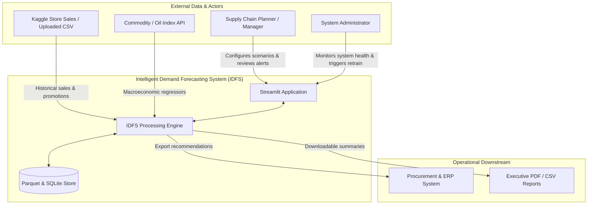
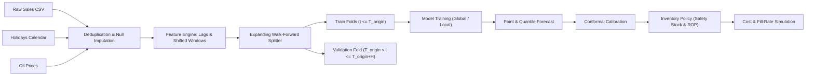
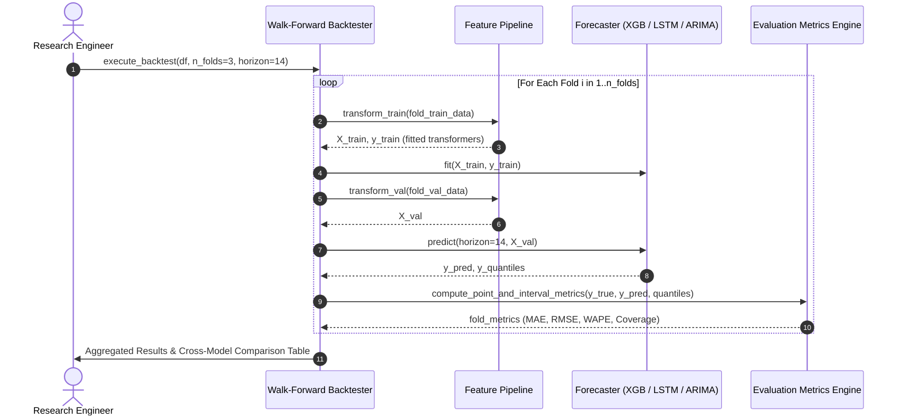
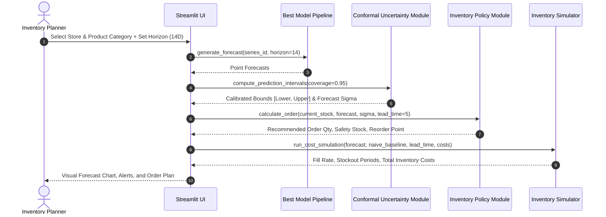
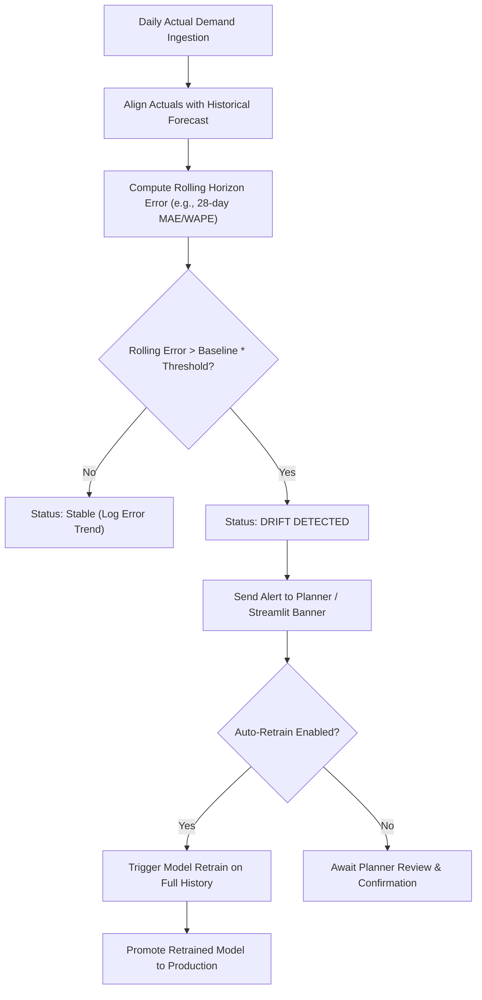
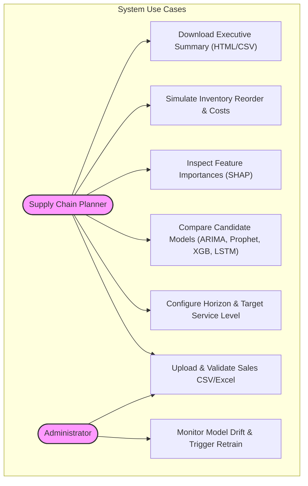

# System Architecture & Technical Design

## 1. Architectural Overview & Design Philosophy

The Intelligent Demand Forecasting System (IDFS) is organized as a strictly unidirectional layered pipeline:
$$\text{Data Ingestion} \longrightarrow \text{Feature Engineering} \longrightarrow \text{Model Forecasting} \longrightarrow \text{Uncertainty \& Evaluation} \longrightarrow \text{Inventory Optimization} \longrightarrow \text{Reporting \& App}$$

### Core Invariants & Engineering Guarantees
1. **Unidirectional Dependency Graph**: Modules in higher-level packages never import downstream packages. Upstream components remain completely agnostic to user interface or deployment mechanics.
2. **Unified Forecaster Interface**: Every forecasting paradigm (classical statistical, tree-based ML, sequence deep learning, intermittent heuristic) inherits from the abstract base class `Forecaster`, enabling plug-and-play evaluation.
3. **Leakage Prevention by Construction**: Temporal boundaries are enforced strictly at the feature transformer level (`.shift(1)` applied before all rolling windows) and split level (expanding rolling-origin folds).
4. **Graceful Multi-Source Degradation**: If optional data channels (e.g. oil prices or promotional schedules) are unavailable, the fusion engine safely falls back to core sales-only representations.
5. **Compute Scalability**: Global models (XGBoost, LSTM) cross-train across all series concurrently; local per-series models (ARIMA, Prophet) are budgeted to representative stratified subsets.

---

## 2. Mermaid Architecture Diagrams

### A. System Context Diagram


### B. Component & Module Architecture

```mermaid
graph TD
    subgraph Layer1["1. Data Layer (idfs.data)"]
        Ingestion["Ingestion Engine"]
        Validation["Schema & Quality Validator"]
        Fusion["Multi-Source Fusion"]
        Synthetic["Synthetic Generator"]
    end

    subgraph Layer2["2. Feature Layer (idfs.features)"]
        Lags["Lag Transformer (t-1, ..., t-k)"]
        Rolling["Rolling Stats (Shifted Mean, Std)"]
        Calendar["Calendar & Holiday Features"]
        Encoders["Target & Categorical Encoders"]
    end

    subgraph Layer3["3. Model Layer (idfs.models)"]
        ForecasterABC["Forecaster (Abstract Base)"]
        Baselines["Naive & Seasonal Naive"]
        XGB["Global XGBoost"]
        LSTM["Global PyTorch LSTM"]
        Statistical["ARIMA / SARIMA & Prophet"]
        Router["Demand-Pattern Router (ADI / CV2)"]
    end

    subgraph Layer4["4. Uncertainty & Evaluation (idfs.uncertainty, idfs.evaluation)"]
        Backtester["Walk-Forward Backtester"]
        Metrics["Metrics Engine (MAE, RMSE, WAPE, MASE)"]
        Quantiles["Quantile Regressor"]
        Conformal["Split Conformal Calibrator"]
    end

    subgraph Layer5["5. Decision & Operational Layer (idfs.inventory, idfs.monitoring)"]
        InventoryModel["Periodic Review (R, S) Policy"]
        Simulator["Daily Inventory Simulator Engine"]
        Drift["Rolling Error Drift Monitor"]
        Explain["SHAP Attribution & What-If"]
    end

    subgraph Layer6["6. Presentation & Delivery (idfs.app, idfs.reporting)"]
        App["Streamlit Multi-Page UI"]
        Reports["HTML / CSV Report Builder"]
    end

    Layer1 --> Layer2
    Layer2 --> Layer3
    Layer3 --> Layer4
    Layer4 --> Layer5
    Layer5 --> Layer6
```


### C. Data-Flow Pipeline


### D. Training and Backtest Sequence Diagram


### E. Inference & Inventory Decision Sequence Diagram


### F. Monitoring & Retrain Loop


### G. Use Case & Activity Diagram (Aligned to Student Mid-Term Report)


---

## 3. Subsystem Deep Dive & Scientific Defenses

### A. Data Layer (`src/idfs/data`)
- **Ingestion**: Accepts CSV or Parquet files containing sales records and multi-source regressors.
- **Validation**: Enforces strict schema assertions: non-empty dates, continuous time indices, non-negative target values, and known categorical foreign keys.
- **Source Fusion**: Joins transaction counts, oil commodity proxies, holiday calendars, and store attributes on `(date, store_id)`. Missing regressors trigger deterministic zero-imputation or forward-fills with logged warnings.

### B. Feature Engineering (`src/idfs/features`)
- **Leakage Defense**: For any time $t$, feature calculations may only incorporate records from $\tau < t$. Lag features start at $k \ge 1$. Rolling statistical aggregates (e.g. 7-day or 28-day rolling mean) strictly execute `df['sales'].shift(1).rolling(w).mean()`.
- **Calendar & Exogenous Encodings**: Day-of-week, day-of-month, day-of-year, and month are transformed into cyclical sine/cosine pairs and categorical encodings. Ecuadorian national, regional, and transferred holidays are flagged.

### C. Model Zoo (`src/idfs/models`)
All forecasters implement:
```python
class Forecaster(ABC):
    def fit(self, train_df: pd.DataFrame, target_col: str, series_id_cols: list[str]) -> Forecaster: ...
    def predict(self, horizon: int, features_df: pd.DataFrame | None) -> pd.DataFrame: ...
    def predict_interval(self, horizon: int, coverage: float, features_df: pd.DataFrame | None) -> pd.DataFrame: ...
```
- **XGBoost**: Trained globally with store and family categorical feature embeddings and full lag structures. Fast, handles nonlinearities, and supports quantile objectives.
- **PyTorch LSTM**: Sequential recurrent network mapping historical windows of length $L=28$ to future sequence targets with MinMax scaling fit exclusively on training slices.
- **Statistical (ARIMA/SARIMA & Prophet)**: Local per-series benchmarks deployed on stratified series subsets to evaluate classical additive and autoregressive performance.
- **Intermittent Specialist (Croston/TSB)**: Specifically designated for low-frequency, erratic items identified by the Router (Novelty N3).

### D. Uncertainty Quantification (`src/idfs/uncertainty`)
- Combines direct quantile loss estimation ($\tau \in \{0.05, 0.50, 0.95\}$) with split conformal prediction.
- Non-conformity scores computed on validation slices adjust interval bounds to guarantee finite-sample coverage at nominal $(1-\alpha)$ levels.

### E. Inventory Decision Engine (`src/idfs/inventory`)
- Operates a $(R, S)$ Periodic Review Policy: Every $R$ days, review inventory position (stock on hand + on order - backorders). Order up to $S = \hat{D}_{R+L} + z \cdot \hat{\sigma}_{R+L}$.
- Simulation tracks stockouts, holding costs ($c_h$), unmet demand penalties ($c_s$), and order placement costs ($c_o$), proving the commercial value of calibrated forecasts over static moving averages.
